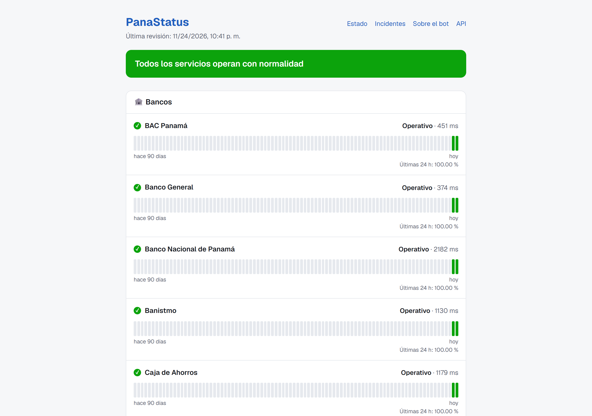
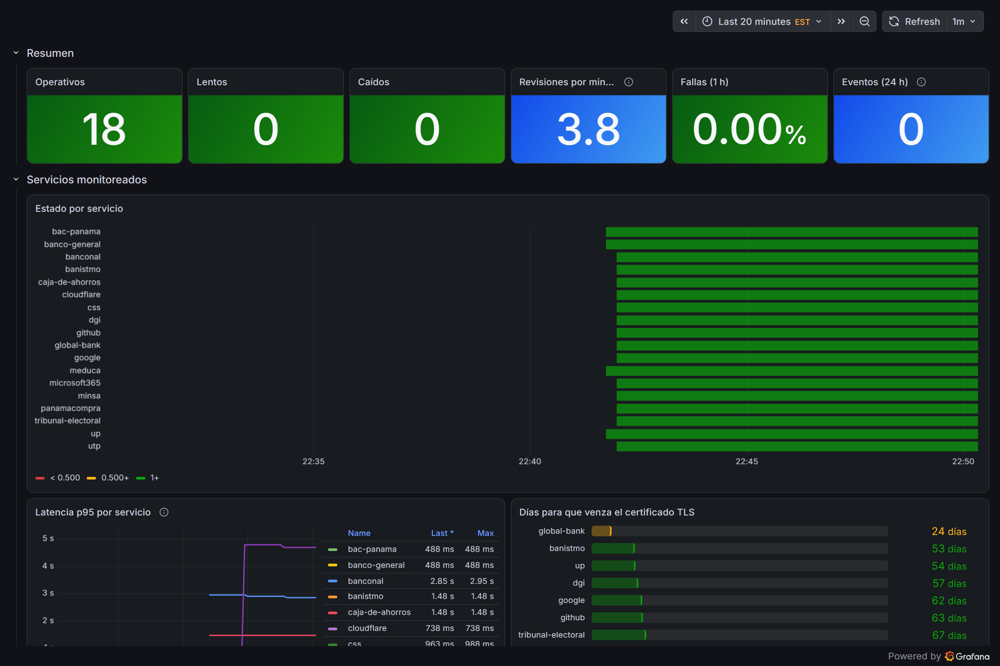
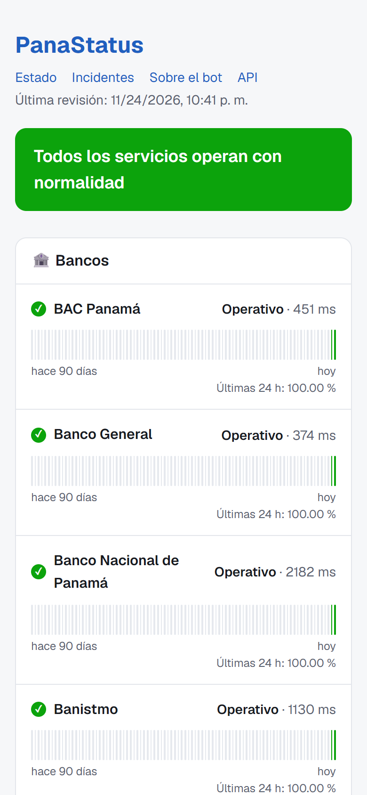
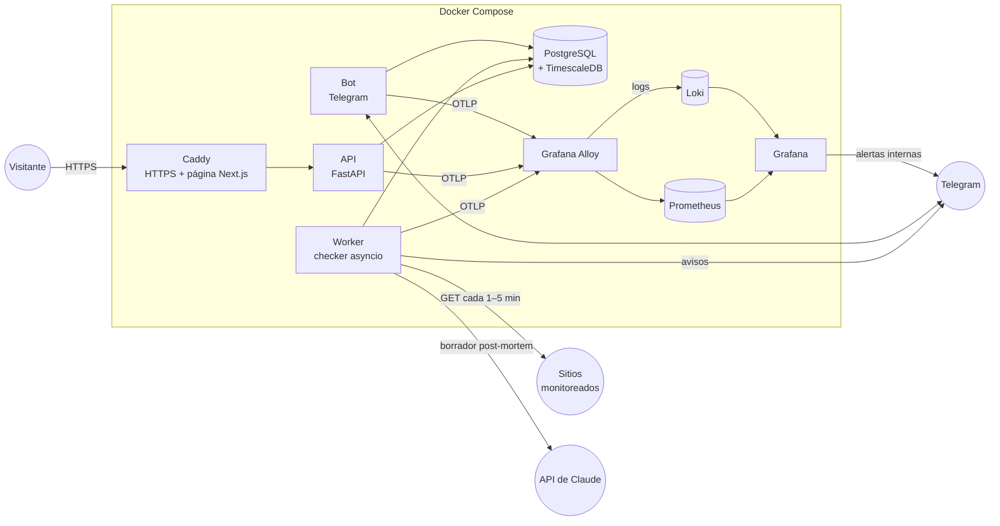

# PanaStatus

**Monitor público de disponibilidad de servicios web de Panamá**: bancos, gobierno, universidades y servicios globales. Revisa cada sitio cada 1–5 minutos, publica el estado en una página web, avisa por Telegram cuando algo se cae y redacta con IA el post-mortem de los incidentes largos.

> Proyecto de portafolio orientado a **soporte de aplicaciones, observabilidad y confiabilidad (SRE)**. Todo el sistema (9 servicios) se levanta con un solo comando de Docker Compose.

## Capturas

**Página de estado**: estado general, servicios por categoría, barra de 90 días y disponibilidad de 24 h.



**Dashboard de operación en Grafana**: servicios operativos, tasa de fallas, estado por servicio, latencia p95 y vigencia de certificados TLS.



<details>
<summary>Vista en móvil</summary>



</details>

## Qué hace

| | |
|---|---|
| **Checker** | Revisa cada servicio (HTTP, latencia, días de vigencia del certificado TLS). Una caída se confirma con 2 fallas seguidas, para evitar falsas alarmas. |
| **Incidentes** | Se abren al confirmar la caída y se cierran al recuperarse, con su duración. |
| **Bot de Telegram** | `/servicios` (suscripción con botones), `/estado`, `/silencio`, `/stop`. Funciona en grupos. Avisa de caídas, recuperaciones y lentitud. |
| **Página de estado** | Banner general, servicios por categoría, barra de 90 días, latencia de 24 h e historial de incidentes. |
| **API pública** | REST de solo lectura con límite de peticiones; documentación en `/api/docs`. |
| **Post-mortems con IA** | Para caídas de 15 min o más, Claude redacta un borrador *blameless* que el admin aprueba desde Telegram antes de publicarlo. |
| **Observabilidad interna** | Métricas OpenTelemetry, logs centralizados, dashboard y alertas si el propio monitor falla. |
| **Reportes** | Capa de reportes en estrella para Power BI: disponibilidad, MTTR, MTBF y SLO. |

## Arquitectura



| Módulo | Responsabilidad |
|---|---|
| `checker.py` | Una revisión HTTP → `CheckResult` (sin DB ni alertas) |
| `state.py` | Máquina de estados pura: caída / recuperación / lentitud |
| `worker.py` | Bucle por servicio: revisar → guardar → evaluar → notificar |
| `notifier.py` | Avisos a Telegram (admin + suscriptores) |
| `postmortem.py` | Borradores de post-mortem con Claude y revisión del admin |
| `telemetry.py` | Métricas OpenTelemetry |
| `db.py` | Todo el SQL (asyncpg, sin ORM) |
| `api.py` / `bot.py` | API REST / comandos del bot |
| `frontend/` | Página de estado (Next.js + TypeScript + Tailwind, exportada estática) |

## Stack

**Backend:** Python 3.12, asyncio, httpx, Pydantic, FastAPI, python-telegram-bot · **Datos:** PostgreSQL 17 + TimescaleDB (hypertable, agregado continuo, retención) · **Frontend:** Next.js 16, TypeScript, Tailwind, SWR · **Observabilidad:** OpenTelemetry, Grafana Alloy, Prometheus, Loki, Grafana · **Infraestructura:** Docker Compose, Caddy (y, para producción, OpenTofu + Oracle Cloud ARM) · **CI/CD:** GitHub Actions, GHCR, Ruff, pytest, ESLint, Trivy, gitleaks · **IA:** API de Claude · **BI:** Power BI.

## Correr en local

Necesitas Docker y [uv](https://docs.astral.sh/uv/).

```bash
cp .env.example .env              # y complétalo
docker compose up -d --build
```

| URL | Qué es |
|---|---|
| http://localhost:8080 | Página de estado |
| http://localhost:8080/api/docs | API (Swagger) |
| http://localhost:3001 | Grafana (usuario `admin`, contraseña `GRAFANA_ADMIN_PASSWORD`) |

Desarrollo:

```bash
uv sync && uv run pytest                  # tests de Python
uv run python -m panastatus.worker --once # revisar todo una vez (valida URLs nuevas)
cd frontend && npm ci && npm run dev      # página en http://localhost:3000 con recarga en vivo
```

## Calidad y seguridad

- **CI** en cada PR: Ruff, pytest, ESLint, TypeScript, build, `npm audit`, `tofu validate`, validación de compose y **gitleaks** sobre todo el historial.
- **CD**: imágenes multi-arquitectura con SBOM y procedencia, **escaneo Trivy**, despliegue con verificación de salud y **rollback automático**.
- Acciones de GitHub fijadas por SHA; versiones de imágenes y dependencias fijadas; Dependabot.
- Secretos solo en `.env` y GitHub Secrets. Solo Caddy expone puertos; base de datos, Grafana y Prometheus nunca se exponen a internet.
- Cabeceras de seguridad (CSP, HSTS, nosniff); contenedores sin root; servidor con SSH solo por clave, fail2ban y parches automáticos.
- Privacidad: del bot solo se guarda el `chat_id` y las suscripciones.

## Monitoreo responsable

Solo se revisan páginas públicas, sin login, con como máximo una petición cada 1 a 5 minutos por servicio (el código lo valida). No se descarga el contenido: el certificado TLS se lee de la misma conexión. Cada petición se identifica:

```
PanaStatusBot/0.1.0 (+https://<dominio>/bot/; panastatus.contacto@gmail.com)
```

La página [`/bot/`](frontend/src/app/bot/page.tsx) explica a los administradores de los sitios qué hace el bot y cómo pedir la exclusión. Las solicitudes se atienden en un máximo de 48 horas: se marca `enabled: false` en `config/services.yaml` con un comentario que indica fecha y motivo.

## Documentación

- [docs/despliegue.md](docs/despliegue.md): publicar en la nube paso a paso (opcional: el código de infraestructura para Oracle Cloud está listo, pero el proyecto aún no está desplegado).
- [docs/operacion.md](docs/operacion.md): runbook (alertas, respaldos, restauración, problemas comunes).
- [docs/powerbi.md](docs/powerbi.md): reportes y medidas DAX.
- [infra/oracle/README.md](infra/oracle/README.md): infraestructura como código.
