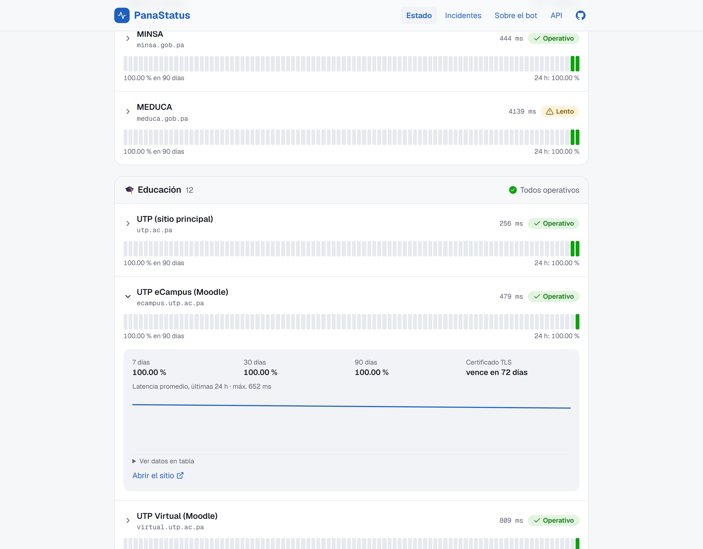
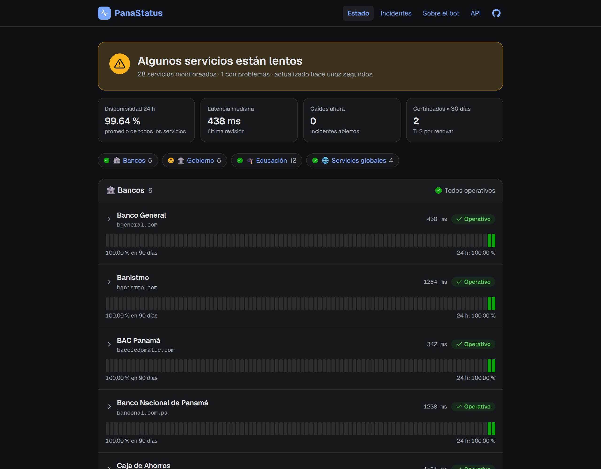
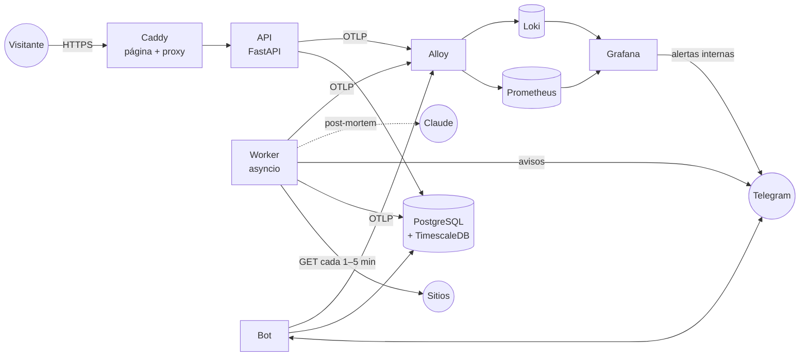

<div align="center">

# PanaStatus

**¿Se cayó o es mi internet?** Monitor independiente de disponibilidad de servicios web
de Panamá: bancos, gobierno, universidades y servicios globales.

[](https://github.com/ahmedalonsoi/panastatus/actions/workflows/deploy.yml)


[](LICENSE)


</div>

Revisa **28 servicios** cada 1–5 minutos, confirma las caídas para evitar falsas
alarmas, registra cada incidente con su duración, avisa por **Telegram** a quien se
suscribe y publica todo en una **página de estado** y una **API pública**. Para los
incidentes largos, redacta con IA un post-mortem que una persona aprueba antes de
publicarse. Y se vigila a sí mismo con **OpenTelemetry, Prometheus, Loki y Grafana**.

> Proyecto de portafolio orientado a **soporte de aplicaciones, observabilidad y
> confiabilidad (SRE)**. Todo el sistema se levanta con un solo comando de Docker Compose.

## Contenido

- [El problema](#el-problema)
- [Qué hace](#qué-hace)
- [Arquitectura](#arquitectura)
- [Inicio rápido](#inicio-rápido)
- [Calidad y seguridad](#calidad-y-seguridad)
- [Decisiones de diseño](#decisiones-de-diseño)
- [Documentación](#documentación)
- [Estado y próximos pasos](#estado-y-próximos-pasos)
- [Monitoreo responsable](#monitoreo-responsable)

## El problema

Cuando la banca en línea, la página de la CSS o el eCampus de la UTP no cargan, nadie
sabe si el problema es del sitio, del proveedor de internet o del propio equipo. Panamá
no tiene una página pública que responda eso. PanaStatus la ofrece y, de paso, construye
un historial de disponibilidad que permite medir con datos (MTTR, MTBF, SLO) cómo se
comportan los servicios digitales del país.

## Qué hace

| | |
|---|---|
| **Monitoreo** | Por cada servicio: código HTTP, latencia y días para que venza el certificado TLS. Caída confirmada con **2 fallas seguidas** ([por qué](docs/adr/0001-caida-confirmada-con-dos-fallas.md)). |
| **Incidentes** | Se abren y cierran solos, con hora de inicio real (la 1.ª falla) y duración calculada por la base de datos. |
| **Bot de Telegram** | `/servicios` para suscribirse con botones, `/estado`, `/silencio`, `/stop`. Funciona en grupos (solo administradores cambian la configuración). |
| **Página de estado** | Estado general, indicadores clave, servicios por categoría, barra de 90 días, latencia de 24 h, historial de incidentes. Accesible, responsiva y con modo oscuro. |
| **API pública** | REST de solo lectura con límite de peticiones y documentación interactiva en `/api/docs`. |
| **Post-mortems con IA** | Para caídas de 15 min o más, Claude redacta un borrador *blameless*; el admin lo publica o descarta desde Telegram ([ADR-0007](docs/adr/0007-ia-con-revision-humana.md)). |
| **Observabilidad interna** | Métricas OpenTelemetry, logs centralizados, dashboard y 3 alertas si el propio monitor falla ([SLO](docs/slo.md)). |
| **Reportes** | Modelo en estrella para Power BI con disponibilidad, MTTR, MTBF y cumplimiento de SLO ([guía](docs/powerbi.md)). |

**Servicios monitoreados** (definidos en [`config/services.yaml`](config/services.yaml)):

| Categoría | Servicios |
|---|---|
| 🏦 Bancos | Banco General, Banistmo, BAC, Banco Nacional, Caja de Ahorros, Global Bank |
| 🏛️ Gobierno | CSS, Tribunal Electoral, DGI, PanamaCompra, MINSA, MEDUCA |
| 🎓 Educación | **UTP** (sitio, eCampus, Virtual, Matrícula), **UP** (sitio, Secretaría Virtual), UNACHI, UDELAS, UMIP, USMA, UIP, Universidad del Istmo |
| 🌐 Globales | Google, GitHub, Cloudflare, Microsoft 365 (ayudan a distinguir "se cayó X" de "se cayó internet") |

<details>
<summary><b>Más capturas</b>: detalle de un servicio, móvil, modo oscuro y Grafana</summary>

**Detalle de un servicio**: disponibilidad 7/30/90 días, certificado y latencia de 24 h.



**Modo oscuro**



**Dashboard de operación en Grafana**


**Móvil**


</details>

## Arquitectura



Tres procesos (worker, api, bot) a partir de una sola imagen, una base de datos y un
stack de observabilidad, todo en Docker Compose. El recorrido de una revisión, la
máquina de estados, el modelo de datos y los modos de falla están en
**[docs/arquitectura.md](docs/arquitectura.md)**.

| Módulo | Responsabilidad |
|---|---|
| [`checker.py`](src/panastatus/checker.py) | Una revisión HTTP → `CheckResult` (sin DB ni alertas) |
| [`state.py`](src/panastatus/state.py) | Máquina de estados **pura**: caída, recuperación, lentitud |
| [`worker.py`](src/panastatus/worker.py) | Bucle por servicio: revisar → guardar → evaluar → notificar |
| [`notifier.py`](src/panastatus/notifier.py) | Avisos a Telegram con reintentos y limpieza de suscriptores |
| [`postmortem.py`](src/panastatus/postmortem.py) | Borradores con Claude y revisión del admin |
| [`db.py`](src/panastatus/db.py) | Todo el SQL (asyncpg, parametrizado, sin ORM) |
| [`api.py`](src/panastatus/api.py) / [`bot.py`](src/panastatus/bot.py) | API REST / comandos del bot |
| [`telemetry.py`](src/panastatus/telemetry.py) | Métricas OpenTelemetry |
| [`frontend/`](frontend/) | Página de estado (Next.js + TypeScript + Tailwind, exportada estática) |

**Stack.** Python 3.12 · asyncio · httpx · Pydantic · FastAPI · python-telegram-bot ·
PostgreSQL 17 + TimescaleDB · Next.js 16 · TypeScript · Tailwind · SWR · OpenTelemetry ·
Grafana Alloy · Prometheus · Loki · Grafana · Docker Compose · Caddy · GitHub Actions ·
GHCR · OpenTofu · API de Claude · Power BI.

## Inicio rápido

Necesitas **Docker**. Para desarrollar, además [uv](https://docs.astral.sh/uv/) y Node 24.

```bash
git clone https://github.com/ahmedalonsoi/panastatus.git && cd panastatus
cp .env.example .env              # complétalo: los comentarios explican cada valor
docker compose up -d --build      # 9 servicios; las migraciones corren solas
```

| URL | Qué es |
|---|---|
| http://localhost:8080 | Página de estado |
| http://localhost:8080/api/docs | API (Swagger) |
| http://localhost:3001 | Grafana (usuario `admin`, contraseña `GRAFANA_ADMIN_PASSWORD`) |

Sin token de Telegram el sistema funciona igual: los avisos quedan en el log.
Comandos de desarrollo y pruebas: **[CONTRIBUTING.md](CONTRIBUTING.md)**.

## Calidad y seguridad

| Área | Qué se hace |
|---|---|
| **Pruebas** | Unitarias (máquina de estados, checker, API, notificador, config, post-mortems), **integración contra TimescaleDB real** y Vitest en el frontend. Cobertura mínima exigida en CI. |
| **Análisis estático** | Ruff (estilo y errores), **mypy** (tipos), ESLint y TypeScript estricto. Hooks de pre-commit. |
| **CI** | En cada push y PR: Python, integración (migraciones dos veces para probar idempotencia), frontend, OpenTofu, Docker Compose y **gitleaks** sobre todo el historial. |
| **CD** | Imágenes multi-arquitectura (amd64/arm64) con SBOM y procedencia, **Trivy** bloquea vulnerabilidades críticas, despliegue por SSH con verificación de salud y **rollback automático**. |
| **Cadena de suministro** | Acciones fijadas por SHA, versiones exactas, Dependabot, `npm audit`. |
| **Aplicación** | API de solo lectura con límite de peticiones, SQL parametrizado, CSP y HSTS, imagen sin root, solo Caddy expuesto a internet. |
| **Privacidad** | Del bot solo se guarda el `chat_id` y lo que sigue; el rol de Power BI no puede leer esos datos. |

Detalle y cómo reportar vulnerabilidades: **[SECURITY.md](SECURITY.md)**.

## Decisiones de diseño

Cada decisión importante está documentada como **ADR** (contexto, alternativas y
consecuencias) en [docs/adr/](docs/adr/README.md):

| | |
|---|---|
| [0001](docs/adr/0001-caida-confirmada-con-dos-fallas.md) | Una caída se confirma con 2 fallas seguidas |
| [0002](docs/adr/0002-timescaledb-para-series-de-tiempo.md) | PostgreSQL + TimescaleDB para las revisiones |
| [0003](docs/adr/0003-sql-explicito-sin-orm.md) | SQL explícito con asyncpg, sin ORM |
| [0004](docs/adr/0004-un-proceso-por-responsabilidad.md) | Worker, API y bot como procesos separados |
| [0005](docs/adr/0005-frontend-estatico-servido-por-caddy.md) | Next.js exportado estático, servido por Caddy |
| [0006](docs/adr/0006-opentelemetry-y-stack-grafana.md) | OpenTelemetry + Alloy + Prometheus + Loki + Grafana |
| [0007](docs/adr/0007-ia-con-revision-humana.md) | Post-mortems con IA solo con aprobación humana |
| [0008](docs/adr/0008-docker-compose-en-un-servidor.md) | Docker Compose en un servidor, no Kubernetes |
| [0009](docs/adr/0009-monitoreo-responsable.md) | Reglas de monitoreo responsable validadas en código |

## Documentación

| Documento | Para qué |
|---|---|
| [Arquitectura](docs/arquitectura.md) | Componentes, flujo de una revisión, estados, modelo de datos, modos de falla |
| [SLO](docs/slo.md) | Objetivos del propio monitor, presupuesto de errores y alertas |
| [Operación (runbook)](docs/operacion.md) | Qué hacer ante cada alerta, respaldos, restauración, problemas comunes |
| [Despliegue](docs/despliegue.md) | Publicar en la nube paso a paso |
| [Power BI](docs/powerbi.md) | Modelo de reportes y medidas DAX |
| [Infraestructura](infra/oracle/README.md) | OpenTofu para Oracle Cloud |
| [Contribuir](CONTRIBUTING.md) · [Seguridad](SECURITY.md) · [Cambios](CHANGELOG.md) | Flujo de trabajo, política de seguridad, historial de versiones |

## Estado y próximos pasos

- [x] Monitoreo, incidentes, bot, API y página de estado
- [x] Observabilidad interna con alertas
- [x] CI/CD con escaneo de seguridad y rollback
- [x] Post-mortems con IA y revisión humana; capa de reportes para Power BI
- [ ] **Despliegue público**: la infraestructura como código para Oracle Cloud está
      lista, pero el proyecto todavía corre solo en local
- [ ] Revisar desde varias regiones y confirmar caídas por votación
- [ ] Página por servicio con su historial completo
- [ ] CSP con *hashes* (sin `'unsafe-inline'`)

## Monitoreo responsable

Solo se revisan páginas **públicas**, con **una** petición `GET` cada 1 a 5 minutos por
servicio (el código rechaza otros valores). En portales con inicio de sesión se consulta
la página pública de *login* y **nunca** se envían credenciales. No se descarga el
contenido: el certificado TLS se lee de la misma conexión. Cada petición se identifica:

```
PanaStatusBot/0.1.0 (+https://<dominio>/bot/; panastatus.contacto@gmail.com)
```

La página [`/bot/`](frontend/src/app/bot/page.tsx) explica a los administradores de los
sitios qué hace el bot y cómo pedir la exclusión, que se atiende en un máximo de 48
horas. Detalle en el [ADR-0009](docs/adr/0009-monitoreo-responsable.md).

## Licencia

[MIT](LICENSE) © 2026 Ahmed Alonso
