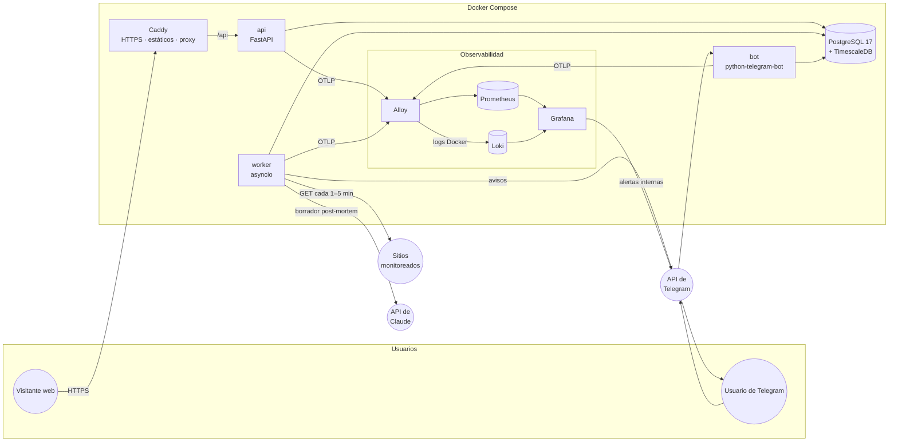
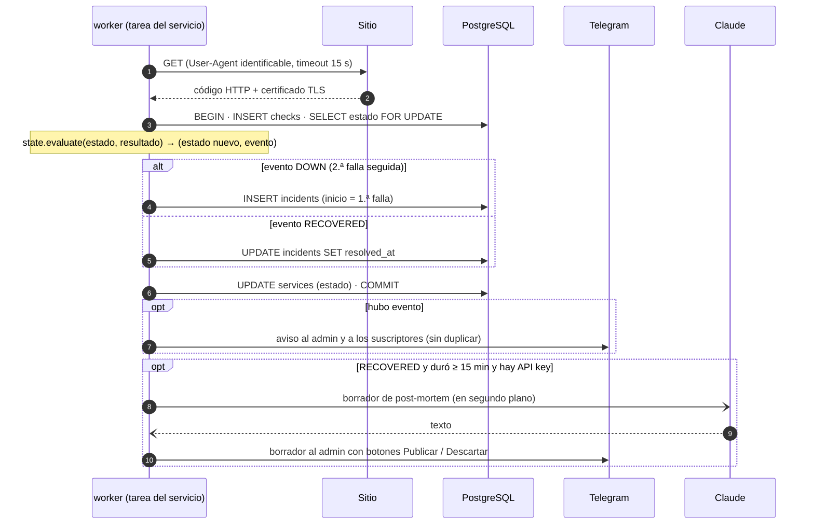
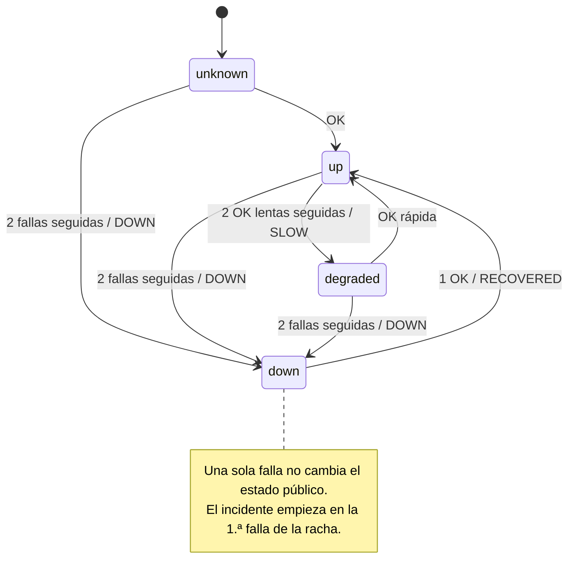
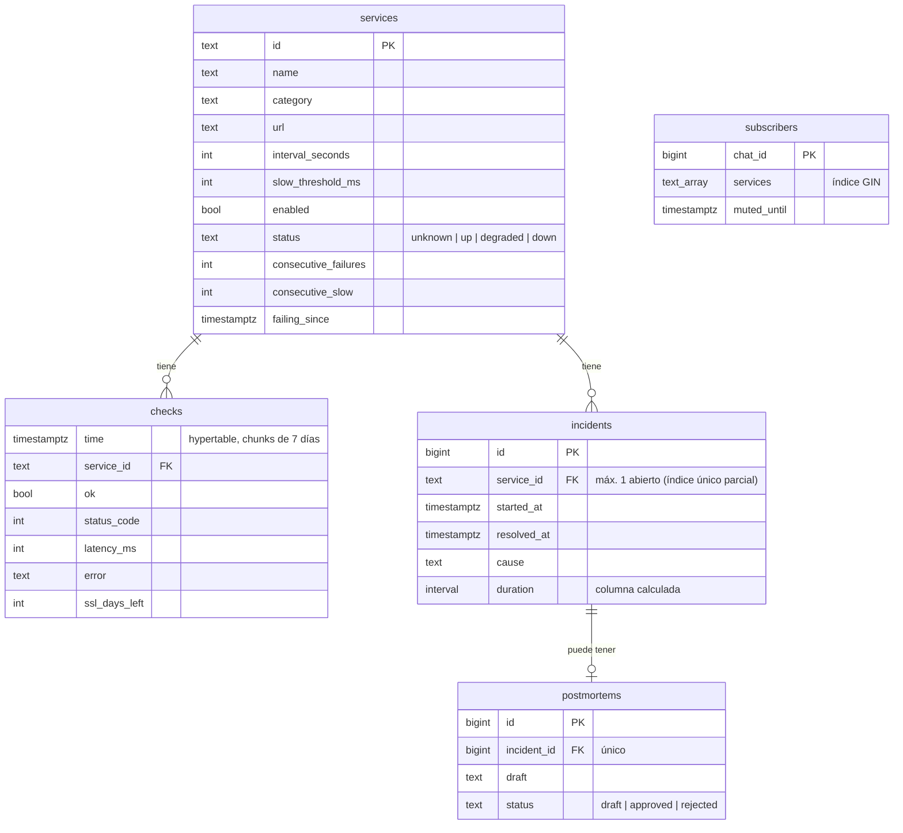

# Arquitectura

Este documento explica **cómo funciona PanaStatus por dentro**: sus componentes, el
recorrido de una revisión, la máquina de estados, el modelo de datos y cómo se comporta
cuando algo falla. Las razones de cada decisión están en los [ADR](adr/README.md).

## 1. Vista general

| Componente | Responsabilidad | Se expone a internet |
|---|---|---|
| **caddy** | Sirve la página (Next.js estático), proxy de `/api` y `/health`, HTTPS automático, cabeceras de seguridad | Sí (80/443) |
| **api** | REST de solo lectura, límite de 60 peticiones/min por IP, documentación en `/api/docs` | Solo a través de Caddy |
| **worker** | Revisa los sitios, guarda, evalúa la máquina de estados, abre/cierra incidentes, avisa | No |
| **bot** | Comandos de Telegram: suscripciones, estado, silencio, revisión de post-mortems | No (*long polling* saliente) |
| **db** | Fuente de verdad: servicios, revisiones, incidentes, suscriptores, post-mortems | No (solo `127.0.0.1`) |
| **migrate** | Aplica migraciones pendientes y termina; el resto espera a que salga con código 0 | No |
| **alloy / prometheus / loki / grafana** | Métricas, logs, dashboard y alertas del propio sistema | No (túnel SSH) |

## 2. Recorrido de una revisión

Puntos clave:

- **Todo en una transacción** con la fila del servicio bloqueada: dos revisiones del
  mismo servicio nunca se pisan.
- Los avisos se envían **después** del `COMMIT`: si Telegram falla, la base ya quedó
  consistente.
- Cada servicio tiene **su propia tarea** asyncio y su intervalo; el inicio se desfasa
  al azar hasta 30 s (*jitter*) para no revisar todo al mismo tiempo.

## 3. Máquina de estados

Implementada como función pura en [`state.py`](../src/panastatus/state.py)
(ver [ADR-0001](adr/0001-caida-confirmada-con-dos-fallas.md)).

## 4. Modelo de datos

| Objeto | Detalle |
|---|---|
| `checks` | Hypertable de TimescaleDB. **Retención de 180 días** (se descartan chunks enteros). |
| `checks_daily` | Agregado continuo por servicio y día **de Panamá**; incluye el día en curso en tiempo real. Alimenta la barra de 90 días. |
| `subscribers` | **Privacidad por diseño**: solo `chat_id` y servicios seguidos. Nada de nombres ni teléfonos. `/stop` borra la fila. |
| Esquema `reporting` | Vistas en estrella para Power BI y el rol `powerbi_reader`, que no puede leer `subscribers` ([docs/powerbi.md](powerbi.md)). |
| `schema_migrations` | Registro de migraciones aplicadas (`db/migrate.sh`). |

## 5. Configuración

| Fuente | Qué contiene | En git |
|---|---|---|
| `config/services.yaml` | **Qué** se monitorea: servicios, categorías, intervalos, umbrales | Sí (es público y auditable) |
| `.env` | Secretos y conexiones: token de Telegram, base de datos, claves | **Nunca** |

Ambas se validan con Pydantic al arrancar: un intervalo fuera de 60–300 s, una
categoría inexistente o un id duplicado detienen el proceso con un mensaje claro.
Al arrancar, el worker sincroniza el YAML con la tabla `services`: lo que sale del YAML
se **desactiva** (no se borra), y al pausar un servicio se cierra su incidente abierto.

## 6. Modos de falla

| Si falla… | Qué pasa | Cómo se detecta |
|---|---|---|
| Un sitio monitoreado | Lo esperado: incidente + aviso | Es el propósito del sistema |
| **Nuestra red o DNS** | Muchos sitios "fallan" a la vez | Alerta *Fallas masivas* (> 50 %); los servicios globales (Google, GitHub) ayudan a distinguirlo |
| El worker | La página muestra datos cada vez más viejos ("actualizado hace X") | Alerta *Checker sin revisiones* (10 min); Docker lo reinicia |
| La API | La página muestra "No se pudo actualizar. Reintentando…" | `/health` responde 503; healthcheck de Docker |
| La base de datos | Worker, API y bot fallan; Docker los reinicia | `/health`, logs en Loki |
| Telegram | Avisos con reintentos (429 respeta `retry_after`); un 403 de un suscriptor lo elimina | Alerta *Envíos a Telegram fallando* |
| La API de Claude | El incidente queda sin borrador; nada más se ve afectado | Log de advertencia |
| El bot | Los avisos **siguen saliendo** (el worker no depende del bot) | Contenedor reiniciado por Docker |

## 7. Seguridad (resumen)

Detalle en [SECURITY.md](../SECURITY.md).

- Solo Caddy escucha en internet; base, Grafana y Prometheus solo en `127.0.0.1`.
- La imagen de Python (worker, api, bot) corre sin root (usuario `app`, uid 1000).
  API de solo lectura con límite de peticiones.
- CSP limitada al propio dominio, HSTS y `nosniff`. Sin scripts de terceros.
- Secretos solo en `.env` y GitHub Secrets; gitleaks en CI y pre-commit.
- Imágenes escaneadas con Trivy; dependencias con Dependabot; acciones fijadas por SHA.
